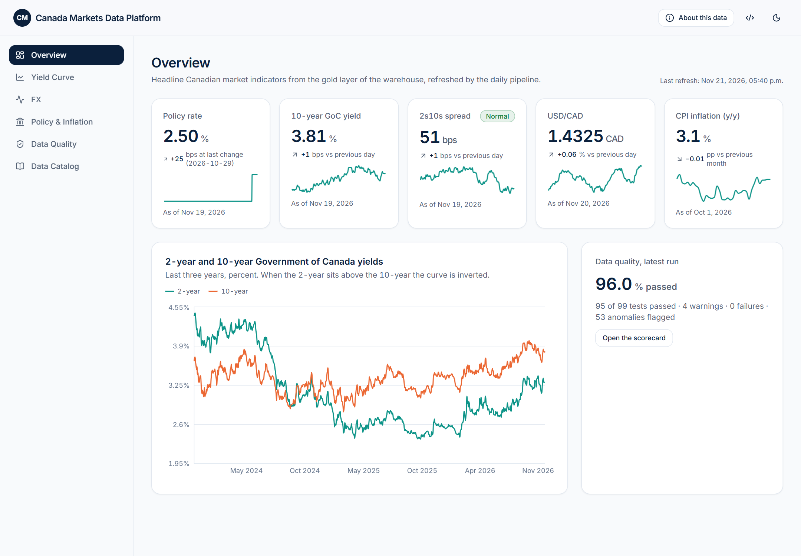
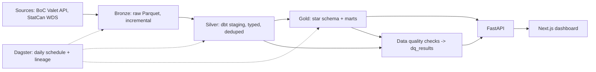
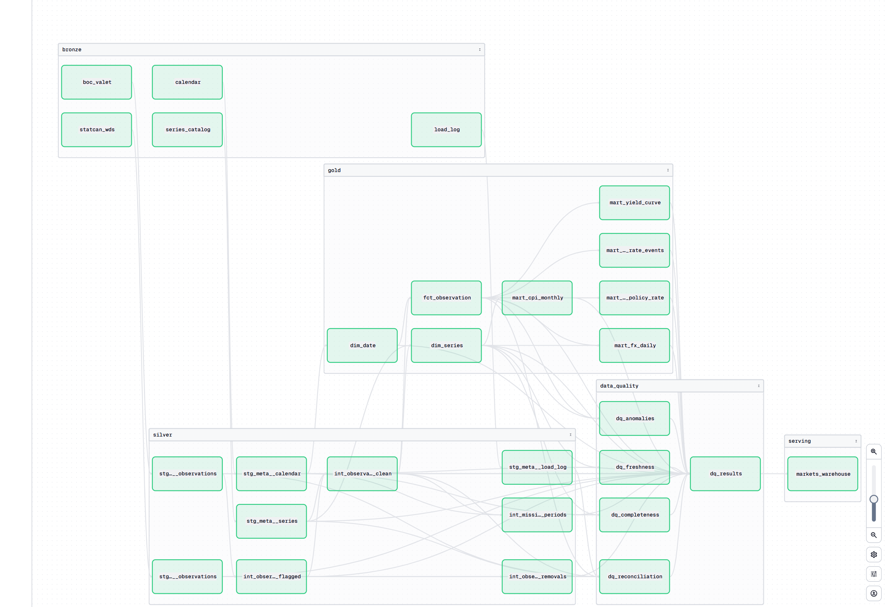
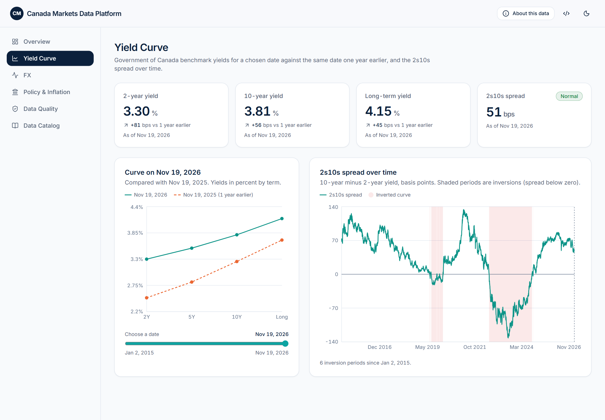
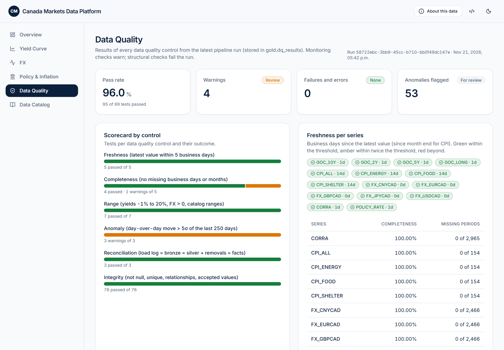
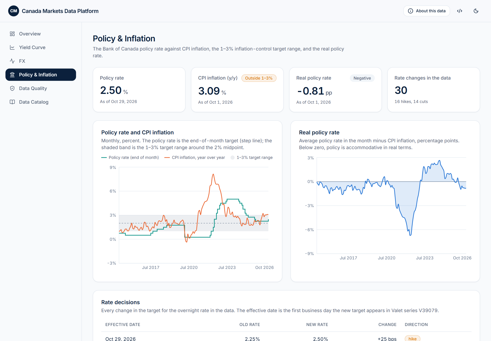
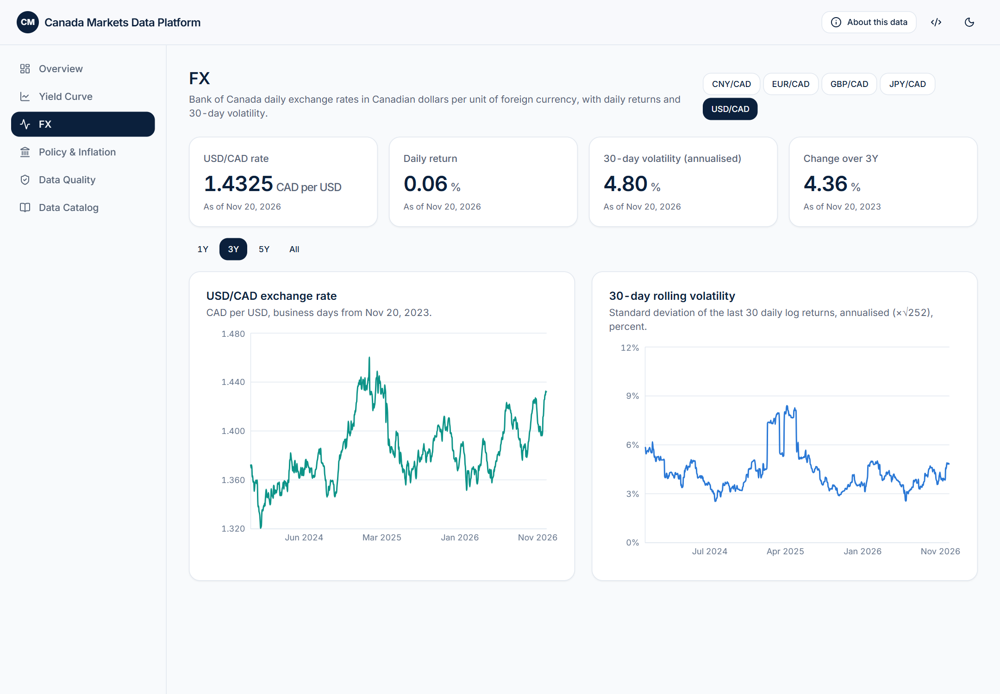

# Canada Markets Data Platform

An automated, tested pipeline that turns Bank of Canada market data and Statistics Canada CPI into a documented star schema with visible data quality checks, served through an API and a dashboard.

[](https://github.com/Gargi4344/canada-markets-data-platform/actions/workflows/ci.yml)




## Architecture



More detail: [docs/ARCHITECTURE.md](docs/ARCHITECTURE.md). Lineage graph from Dagster (bronze → silver → gold → data quality → serving):



## Highlights

<!-- HIGHLIGHTS:START -->
- Built an automated medallion data pipeline (Python, dbt, DuckDB, Dagster) ingesting 15 Bank of Canada and Statistics Canada market series (30,858 rows, bond yields, FX, policy rate, CPI) into a star-schema data model.
- Enforced 99 data quality controls (freshness, completeness, range, anomaly and reconciliation checks) with a 96.0% pass rate, surfaced in a data quality dashboard.
- Delivered a FastAPI service and Next.js dashboard (yield curve, FX volatility, real policy rate) with CI/CD in GitHub Actions and documented data lineage and data dictionary.
<!-- HIGHLIGHTS:END -->

## Problem → Solution

**Problem.** Economists need accurate, timely and well-documented market data. Raw API data
has gaps, holidays, revisions and odd values, and checking it by hand is slow and invisible
to the people who rely on it.

**Solution.** A medallion pipeline that:

1. pulls only new observations from the Bank of Canada Valet API and the Statistics Canada
   Web Data Service and stores them untouched as Parquet (bronze);
2. types, de-duplicates, standardises and calendar-flags them with dbt (silver), keeping a
   record of every row it removes and why;
3. models them as a star schema with analysis-ready marts (gold);
4. runs freshness, completeness, range, anomaly and reconciliation controls on every run and
   stores each outcome in `gold.dq_results`;
5. serves the gold layer read-only through FastAPI to a dashboard that shows the data and
   its quality side by side.

## Features

- **Incremental extract** with retries (httpx + tenacity), load metadata (load id, time, row
  count, source URL) and an offline fixture mode so tests and CI never call the internet.
- **Bank of Canada business-day calendar** (Ontario public and federal holidays plus the
  Civic Holiday), calibrated against Valet publishing days.
- **dbt models** for staging, silver and gold, with every rule documented in `schema.yml`.
- **Star schema**: `dim_date`, `dim_series`, `fct_observation` and marts for the yield curve
  (2s10s spread, inversion flag), FX (returns, 30-day volatility), policy rate decisions,
  CPI inflation and the real policy rate.
- **Data quality framework**: `not_null`, `unique`, `relationships`, `accepted_values` plus
  custom tests for value ranges, freshness (5 business days), completeness, 5-sigma
  anomalies and bronze → silver → fact reconciliation. Monitoring checks warn, structural
  checks fail.
- **Dagster** software-defined assets, lineage graph and a weekday 18:00 Toronto schedule.
- **FastAPI** endpoints for the catalog, series, yield curve, FX, policy rate, data quality
  and health, opened read-only so the pipeline can publish at any time.
- **Next.js dashboard**: Overview, Yield Curve (date slider, one-year comparison, shaded
  inversions), FX, Policy & Inflation (1–3% target band, real rate), Data Quality scorecard
  and a searchable Data Catalog, in light and dark mode.
- **Documentation**: dbt docs (lineage + dictionary), a generated
  [data dictionary](docs/DATA_DICTIONARY.md), an [EDA notebook](notebooks/01_eda.ipynb) and a
  plain-English [walkthrough](docs/WALKTHROUGH.md).

| Yield Curve | Data Quality |
| --- | --- |
|  |  |
| **Policy & Inflation** | **FX** |
|  |  |

## Tech stack

| Layer | Tools |
| --- | --- |
| Extract | Python 3.12, httpx, tenacity, Polars, Parquet |
| Transform and test | dbt-core, dbt-duckdb, DuckDB |
| Orchestration | Dagster, dagster-dbt |
| API | FastAPI, Pydantic v2, Uvicorn |
| Frontend | Next.js 15 (App Router), TypeScript, Tailwind CSS, shadcn/ui, Recharts, TanStack Query, lucide-react, next-themes, Framer Motion |
| Quality and delivery | pytest, ruff, pre-commit, GitHub Actions, Docker Compose, uv |

## Quickstart

Requirements: [uv](https://docs.astral.sh/uv/), Node.js 20+, GNU make. No API keys.

```bash
make setup      # Python deps (uv) + Node deps + pre-commit hook
make dev        # load real data from 2015 to today, then start the API and the dashboard
```

Open the dashboard at http://localhost:3000 and the API docs at http://localhost:8000/docs.

Or with Docker:

```bash
docker compose up --build
```

Other commands (`make help` lists them all):

| Command | What it does |
| --- | --- |
| `make pipeline` | Extract → dbt run → dbt test → publish (incremental after the first run) |
| `make pipeline-fixtures` | The same pipeline offline on the committed fixtures |
| `make test` | pytest (unit tests, end-to-end fixture pipeline, data quality, API) |
| `make dagster` | Dagster UI with the asset lineage and the daily schedule on :3070 |
| `make docs` | dbt docs (served by the API at `/dbt-docs/`) and `docs/DATA_DICTIONARY.md` |
| `make notebook` | Re-execute `notebooks/01_eda.ipynb` against the warehouse |
| `make results` | Measure everything and regenerate `RESULTS.md` and the tables below |

Deployment is not set up; the project runs locally as described above.

## Data sources and licence

- **Bank of Canada** – Valet API (https://www.bankofcanada.ca/valet/docs): target for the
  overnight rate (V39079), CORRA (AVG.INTWO), benchmark bond yields (BD.CDN.2YR/5YR/10YR/LONG.DQ.YLD)
  and daily exchange rates (FXUSDCAD, FXEURCAD, FXGBPCAD, FXJPYCAD, FXCNYCAD). Used under the
  [Bank of Canada terms of use](https://www.bankofcanada.ca/terms/).
- **Statistics Canada** – table 18-10-0004-01, Consumer Price Index, monthly (all-items, food,
  shelter, energy), via the Web Data Service. Contains information licensed under the
  [Open Government Licence – Canada](https://open.canada.ca/en/open-government-licence-canada).

Data is downloaded at runtime and never committed. Small samples in
`backend/tests/fixtures/` let CI run offline. Series IDs were confirmed against
`/valet/lists/series/json` and are listed in [`backend/config/series.yaml`](backend/config/series.yaml).
This project is not affiliated with either institution and is not investment advice.

## Results

<!-- RESULTS:START -->
| Metric | Value |
| --- | --- |
| Series loaded | 15 (11 Bank of Canada, 4 Statistics Canada) |
| Rows in fct_observation | 30,858 |
| Rows in bronze / removed in silver | 30,858 / 0 |
| Date range | 2014-01-01 to 2026-11-20 |
| Data quality tests | 99 |
| Pass rate (passed / total) | 96.0% |
| Tests by status | pass 95, warn 4, fail 0, error 0 |
| Anomalies flagged (5σ, 250-day window) | 53 |
| Missing business days / months | 2 |
| Stale series at as-of date | 0 |
| Policy rate changes since 2015 | 30 |
| Inverted-curve days (2s10s < 0) | 703 of 2,965 |
| Full pipeline runtime (full refresh) | 48.2 s (extract 23.5 s, dbt run 15.6 s, dbt test 9.0 s) |
| Incremental runtime | 17.0 s (0 new rows) |
| pytest | 33 passed, 0 failed (57 s) |

_Measured on 2026-11-22 01:13 UTC by `make results`. Details in [RESULTS.md](RESULTS.md)._
<!-- RESULTS:END -->

## Project structure

```
backend/
  config/series.yaml        confirmed series catalog (IDs, units, thresholds)
  src/cmdp/
    extract/                Valet + StatCan extractors, bronze writer, fixtures
    calendar.py             Bank of Canada business-day calendar
    pipeline.py             CLI: extract -> dbt run -> dbt test -> publish
    dq/results.py           dbt test results -> gold.dq_results
    orchestration/          Dagster assets, job and schedule
    api/                    FastAPI app, routes, schemas, read-only DB access
  dbt/models/               staging, silver, marts (gold) and dq models + schema.yml
  dbt/tests/generic/        custom data quality tests
  tests/                    pytest suite and fixtures
frontend/src/
  app/                      six dashboard pages
  components/               app shell, charts, KPI cards, states, shadcn/ui components
  lib/                      API client, types, formatting
notebooks/01_eda.ipynb      exploration of the gold tables
docs/                       architecture, data dictionary, walkthrough, screenshots
scripts/                    results, data dictionary, fixtures
```

## What I'd do next

- Capture source revisions: re-pull a short look-back window and keep every vintage
  (slowly changing facts) instead of only new dates.
- Add the Bank of Canada decision dates as their own series so policy events carry the
  announcement date, not only the effective date.
- Alerting: post failed or stale checks to Slack or email from the Dagster run.
- Deploy: frontend on Vercel, API and pipeline on Azure Container Apps with the warehouse
  on object storage.
- More series: provincial CPI, core inflation measures and the BCPI commodity index.
