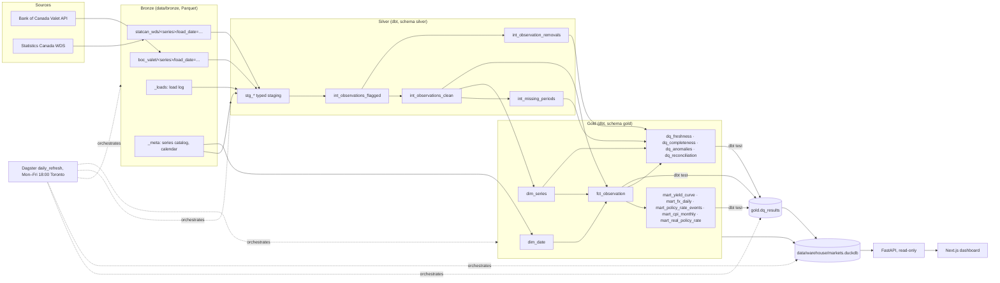
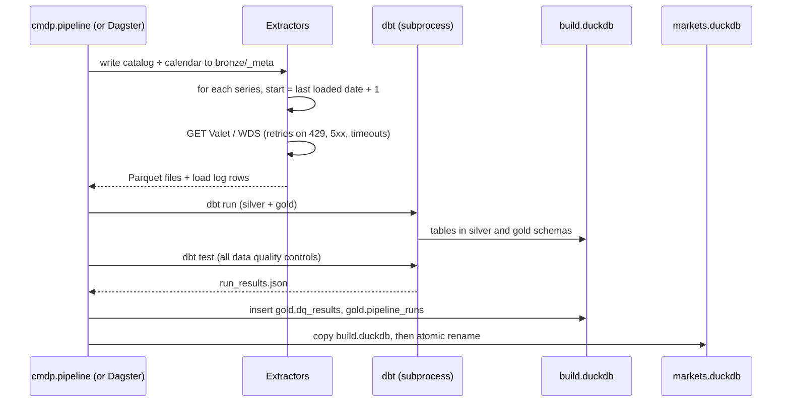

# Architecture

## Overview

## Runtime flow of one pipeline run

## Key design decisions

| Decision | Why |
| --- | --- |
| Bronze is raw text in Parquet, partitioned by series and load date | Reproducible: silver can always be rebuilt from bronze; load metadata gives lineage back to the exact URL. |
| Incremental by "last loaded date + 1" | Fast daily runs and polite use of public APIs. |
| DuckDB file per environment, published by copy + rename | The API reads a stable file while the next build runs; no lock contention on Windows or Linux. |
| dbt runs in a subprocess | Releases DuckDB file handles at exit so the build can be published immediately. |
| All models materialised as tables | The published file is self-contained (no views pointing at Parquet paths). |
| Monitoring checks warn, structural checks error | Source gaps and market shocks are findings to show, not reasons to stop serving data; broken keys or impossible values are. |
| Business-day calendar from the `holidays` package plus the Civic Holiday | Calibrated against Valet publishing days so completeness checks flag real gaps only. |
| Fixture transport for httpx | Tests and CI exercise the real extract code path with no network access. |
| Read-only, per-request DuckDB connections in the API | No write path from the internet; connections never pin the file. |

## Schemas

- `silver`: staging and intermediate models (typed, cleaned, flagged).
- `gold`: star schema, marts, data quality models, `dq_results`, `pipeline_runs`.

See [DATA_DICTIONARY.md](DATA_DICTIONARY.md) for every column.
